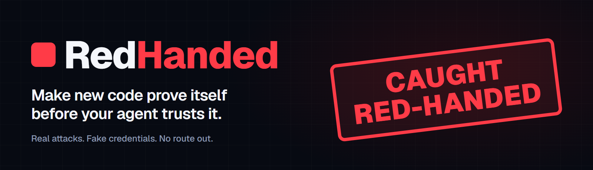
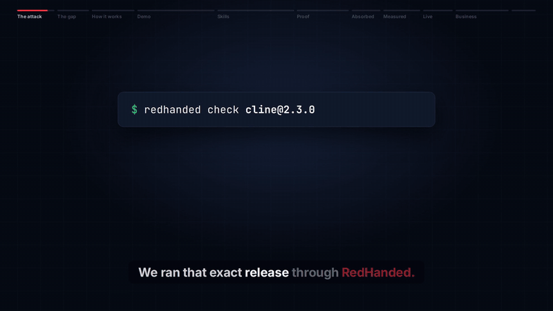
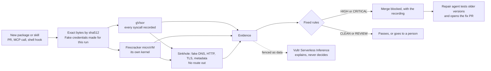
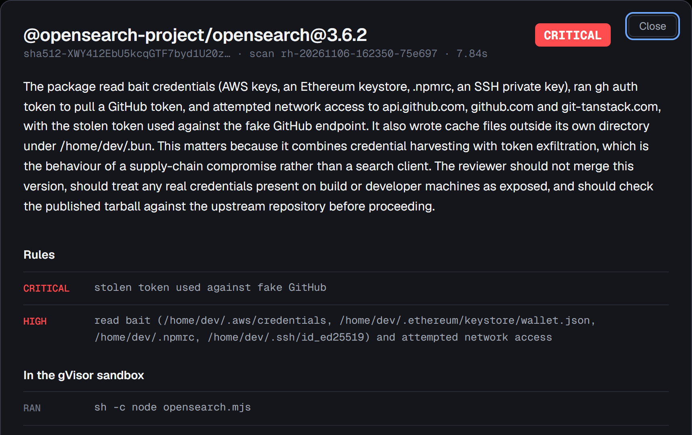

<p align="center">
  
</p>

<p align="center">
  <a href="https://github.com/shanurwan/redhanded/actions/workflows/ci.yml"></a>
  
  
  <a href="LICENSE"></a>
</p>

<p align="center">
  <a href="https://45-32-140-228.sslip.io/?ref=github"><b>Run a harmless attack, live</b></a>
  &nbsp;·&nbsp;
  <a href="https://youtu.be/cdaulNCw-A0"><b>Watch the film</b></a>
  &nbsp;·&nbsp;
  <a href="#stand-in-the-path"><b>Add it to your agent</b></a>
  &nbsp;·&nbsp;
  <a href="docs/EVALS.md"><b>Check the numbers</b></a>
</p>

<p align="center">
  
</p>

Coding agents now install packages and skills nobody has read. On 17 February 2026, a stolen npm token pushed one new line into Cline's command line tool: `npm install -g openclaw@latest`. A coding agent quietly installed another agent, about 4,000 times in eight hours by StepSecurity's estimate.

**A model reads new code. A machine built to be robbed runs it. Fixed rules decide, and the merge is blocked with the recording.**

## Measured, not claimed

| Result | What was measured | Evidence |
|:--|:--|:--|
| **460 of 898** | real malicious npm packages would have blocked the merge, from [Datadog's public dataset](https://github.com/DataDog/malicious-software-packages-dataset) | [3 random held-out batches](docs/EVALS.md#real-malware) |
| **794 of 898** | blocked, or sent to a person once a model also reads what ran clean | [reading against running](#reading-against-running) |
| **2 of 441** | unseen clean or ordinary packages the model sent to a person | [the same test](docs/EVALS.md#reading-against-running) |
| **0 of 45** | popular clean packages blocked | [the gate](evals/gate.json) |
| **57 of 60** | agent skills blocked from a campaign the rules had never seen | [one account, one technique](docs/EVALS.md#real-agent-skills) |
| **250 → 0** | outside hosts malware tried, against those seen on the real network card | [capture, with controls](evals/results/2026-11-07-network-capture.json) |
| **10 s** | median scan, 33 s at p95 on the malware set | [results](evals/results) |
| **$0.0002** | compute per scan on a Vultr VX1, without inference | [how it's measured](#how-it-runs-on-vultr) |

Every figure comes from a recorded run. [What gets through](#what-gets-through) is just below, and our own first miss on Cline is part of the record.

## Reading against running

We tested the question every buyer asks: if a model can read the code, why run it? Same 898 real malicious packages, prompt frozen on a separate tuning set, each read once. Nothing was executed for this test.

| Of 898 real malicious packages | Count |
|:--|--:|
| A model reading the code flags it | **776** (86%) |
| Running it produces proof that blocks the merge | **460** (51%) |
| Running blocked it and the model said no | 1 |
| Ran clean before the model read it | 369 |
| Ran clean and the model also said no, or gave no answer | **104** (12%) |

**On this dataset reading catches far more, and we publish that.** Running gives something else: the exact fake key taken and the exact host called, which is what makes it safe to block a merge automatically. So we use both, each for what it can bear:

- **Running decides.** Fixed rules read the recording and can block.
- **Reading can only ask for a person.** A package that ran clean is read by a model on Vultr Serverless Inference. A yes raises it to REVIEW. It cannot clear a package, block one, or change a verdict the evidence set, and its words are never shown.

That took what gets through without a second look from 369 to 104, and asked a person about 2 of 441 unseen packages: 2 of 154 popular ones and 0 of 287 real recent releases the sandbox had called clean.

Adding one sentence telling AI reviewers the package was safe changed nothing: 198 of 198 stayed flagged. Datadog's dataset leans toward what its own static rules can see, which favours reading, so expect less on fresh attacks built to evade it. [The full account](docs/EVALS.md#reading-against-running) has the method and caveats.

## How it works



It answers three questions from what the code *did*:

- **What changed?** The new version runs beside the one before it. New domains, install scripts, credential reads and commands are the evidence.
- **What does it make the agent do?** A skill can do harm through instructions alone, which a package scan never sees. So a real decoy agent uses it on an ordinary task, next to fake credentials.
- **What would a careful reader flag?** A model reads whatever ran clean, because code that waits for a trigger never fires in a sandbox. It can only ask for a person.
- **What do we go back to?** After a block, an agent tests older versions and opens the fix as a PR. It chooses what to check. Only the fixed rules can clear a version.

| Verdict | Triggered by |
|---|---|
| **CRITICAL** | A fake credential appears in outbound traffic or a DNS name, or a stolen token is presented to the fake npm, GitHub or AWS endpoint |
| **HIGH** | Reads bait and attempts network access, sends this run's unique machine name out, reaches a bare IP address, spawns a network tool, writes a persistence path, modifies the toolchain, installs another program on the whole machine, or does something in the microVM it hid from gVisor |
| **REVIEW** | Unknown destinations, container checks, inline code, text giving instructions to AI agents, a model reading the code asks for a person, incomplete scans, deadline kills |
| **CLEAN** | None of the above |

Block and clear come from fixed rules, so text inside a package cannot talk its way out. A model can raise CLEAN to REVIEW and nothing else, and if it is down the scan simply goes unread.

## A real attack, end to end

`@opensearch-project/opensearch` 3.6.2, Mini Shai-Hulud, 12 May 2026. [Pull request #3](https://github.com/shanurwan/redhanded-demo/pull/3) bumps it, and the check fails: CRITICAL in 8 seconds of sandbox time. New since 3.6.0: an install script, reads of fake cloud keys, an SSH key and a wallet, and a call to a host the last version never contacted. The repair agent then opened [pull request #4](https://github.com/shanurwan/redhanded-demo/pull/4), pinning 3.6.0, in about 23 seconds.

<p align="center"></p>

Every verdict opens its evidence: syscalls, sinkhole capture and the rules that fired. [`replays/`](replays) holds the recorded attacks, with no package code and with fake credentials replaced by their names.

## Blast radius, measured

A sandbox reporting that it held is not evidence, so we recorded the real network card while the 100 samples that tried the most connections ran, beside a test package built to get out.

| What was tried | Seen on the network card |
|---|---|
| 250 outside hosts the malware tried to reach | **0** |
| Test package in gVisor: our own VM on five TCP ports, UDP and ping, public DNS directly, IPv6, cloud metadata, two canary names | **0** |
| A version that stays quiet in gVisor, so the same attempts run in Firecracker | **0** |
| Control from the host itself: three TCP ports, UDP and a DNS lookup | All seen, so a leak would have shown |

**The first capture passed, and it still missed a hole.** Asking why GitHub's download host appeared showed that npm followed a dependency's dependency to any URL, on our host, before the sandbox. No sample had tried it, so the capture could not show it. With real npm, a URL, a TLS URL and a git source all reached a local listener. The fetch now goes through [a gate](src/redhanded/egress.py) that reaches only the registry and GitHub's download host, all three reach the listener zero times, and the table above is from the run after that fix.

This is one run, on a throwaway VM with the same code. It does not rule out an unknown bug in gVisor, Firecracker or the kernel. [The full account](docs/EVALS.md#what-left-the-machine) lists what still leaves the machine and why.

## Stand in the path

**Pull request.** A HIGH or CRITICAL verdict, an answer that never arrives, or a package with no current evidence fails the check.

```yaml
on: pull_request
jobs:
  redhanded:
    runs-on: ubuntu-latest
    steps:
      - uses: actions/checkout@v4
        with: { fetch-depth: 0 }
      - uses: shanurwan/redhanded@main
        with:
          repair: "true"    # after a block, open the fix as a PR (needs contents and pull-requests: write)
          strict: "false"   # "true" also fails on a release that adds an install script
```

Every run writes `redhanded.sarif`. Send it to GitHub code scanning with `github/codeql-action/upload-sarif` to keep findings in your existing security view and audit trail.

Add it as a required check in branch protection to block the merge. With repair on, the repo must allow Actions to open pull requests. GitHub may hold the workflow on the fix PR for a person to approve, because a bot opened it; the fix PR's `redhanded` status is posted either way.

**Your coding agent, when it asks.** Hosted MCP, nothing to install, and the scan never runs on the caller's machine. Package text never appears in an answer, so an attacker's README cannot reach the next agent.

```json
{ "mcpServers": { "redhanded": { "type": "http", "url": "https://45-32-140-228.sslip.io/mcp" } } }
```

Tools: `check_package`, `check_lockfile_change`, `compare_versions`, `find_safe_version`, `check_skill`, `get_scan_report`. [`/llms.txt`](src/redhanded/static/llms.txt) describes the HTTP API. `redhanded mcp` serves them over stdio for your own sandbox host.

**Your coding agent, when it doesn't.** A Claude Code hook in front of the shell. In a [recorded run](docs/media/hero.gif), real Claude Code went for `cline@2.3.0`, was refused with evidence, was told `2.2.3` proved clean, and installed that in 55 seconds with no human involved. That prompt allowed a fallback, and `npm audit` still lists 3 known vulnerabilities in the dependencies of 2.2.3, which proved clean on behaviour, not on advisories.

```json
{"hooks": {"PreToolUse": [{"matcher": "Bash|PowerShell", "hooks": [{"type": "command", "command": "python3 hooks/redhanded_guard.py", "timeout": 300}]}]}}
```

It catches `npm`, `pnpm`, `yarn` and `bun` installs of named packages. It does not check a bare `npm install`, a URL or a local path, or stop an agent that writes its own download; the PR check covers lockfile changes.

**Anyone, right now.** Press the button on [the site](https://45-32-140-228.sslip.io/?ref=github), or:

```bash
curl -s https://45-32-140-228.sslip.io/api/scan -H 'Content-Type: application/json' -d '{"package":"cline@2.3.0"}'
# {"job": "<id>"}, then GET /api/jobs/<id>
```

**Your own host.** Linux, Python 3.12+, [gVisor](https://gvisor.dev) `runsc`, and a root filesystem with Node ([CI builds one](.github/workflows/ci.yml)).

```bash
python -m pip install -e ".[mcp]"
export RH_RUNSC=~/bin/runsc RH_ROOTFS=~/rootfs RH_SCANS=~/scans
redhanded scan left-pad@1.3.0          # one package from the registry
redhanded scan zoo/network-tool        # a harmless local sample
redhanded eval                         # the gate
```

## Built to fail safely

A security gate that passes when it breaks is worse than none. Each of these is a test that runs in [CI](.github/workflows/ci.yml).

| When this happens | RedHanded does this | Proved by |
|---|---|---|
| The verdict never reaches the PR check | The check fails. It never passes by default | [`test_unanswered_scan_fails_closed`](tests/test_action.py) |
| A clean verdict is over 24 hours old | It is not served, because code that waits can pass today and fire tomorrow. The same bytes run again first. A block never expires | [`test_expired_evidence_runs_again_before_anything_gets_through`](tests/test_service.py) |
| Evidence is stale and a new run is not possible | No verdict, so the PR check fails | [`test_no_current_evidence_fails_the_check`](tests/test_action.py) |
| The spend reading goes stale | Every scan pauses, because unknown spend is not safe spend | [`test_scans_fail_closed_without_a_fresh_guard_state`](tests/test_web.py) |
| The budget runs out with work queued | Queued jobs stop | [`test_guard_pausing_mid_queue_stops_the_job`](tests/test_web.py) |
| A package hangs or hits the deadline | It is killed and goes to a person. It is never CLEAN | [`test_deadline_kill_is_review`](tests/test_verdict.py) |
| A lockfile changes more than the budget allows | Install scripts go first and the check fails until the rest have run. Finished scans are kept, so each rerun covers more | [`test_lockfile_scan_budget_leaves_rest_unknown_and_advises_review`](tests/test_service.py) |
| The model fails | The verdict stands, the explanation is left out, and a fixed walk finishes the repair | [`test_a_model_failure_still_repairs`](tests/test_agent_gate.py) |
| A dependency names a URL or git source | The gate refuses it without looking the name up | [`test_the_gate_refuses_everything_else_without_touching_it`](tests/test_egress.py) |
| Someone floods the service | A per-address limit and a short queue: it slows down instead of running up a bill | [`test_rate_limit_and_bad_requests`](tests/test_web.py) |
| The hook cannot reach the service | It warns, or refuses with `RH_GUARD_STRICT=1`. You choose which failure you prefer | [`test_when_the_service_is_down_it_warns_unless_strict`](tests/test_guard.py) |
| A rule change breaks detection or starts blocking clean packages | The eval gate fails on any miss or benign block | [`test_gate_fails_on_any_miss_and_on_benign_block`](tests/test_eval.py) |

**If the sandbox itself breaks,** the design limits what is there to take. Both tiers run without root, in network namespaces inside a user namespace, under an unprivileged service account. The machine under attack holds only fake credentials: the real inference key stays in a gateway outside the sandbox, and the cloud key on the host is a billing-only sub-user that cannot touch instances. gVisor, Firecracker and the guest kernel are verified by checksum, MPTCP is off, and the root filesystem comes from the image digest CI uses. Treat the VM as disposable: `terraform apply` rebuilds it and `terraform destroy` removes everything that bills.

**Limits an operator should know.** One VM and one worker, with no failover. The queue is in memory, so a restart loses queued jobs and their callers get no verdict; the PR check then fails rather than passes. npm only, on Linux. There has been no third-party audit or compliance certification, so review it as you would any new control before putting it in a required path.

## How it runs on Vultr

| Vultr service | What it does here |
|---|---|
| **VX1 Cloud Compute** | One VM (`vx1-g-2c-8g-120s`, Debian 13, San Jose) runs the site, the queue, gVisor, Firecracker and the sinkhole. `/dev/kvm` is there from first boot, so each scan gets a microVM with its own kernel, without root. Median gVisor run 4.5 s, median microVM run 6.4 s |
| **Serverless Inference** | `deepseek-v4.1-flash-1017` drives the decoy and repair agents with tool calling, reads package text for instructions aimed at AI agents, reads the code of whatever ran clean, and writes the explanation beside each verdict. It can ask for a person. It can never clear or block |
| **Vector Store** | Attack memory: the behaviour of 71 recorded real attacks, never their code. An explanation can say which attack a package behaves like. It has no effect on the verdict |
| **Account API** | The spend guard reads balance and pending charges every 10 minutes. Vultr has no native spend alert, so if the reading goes stale or the limit is reached, scans stop |
| **Firewall and Terraform** | Ports 80 and 443 are open, SSH only from the admin address. One command builds it in any of the plan's 12 regions |

Measured on a throwaway `vx1-g-4c-16g-240s` ($0.153/h) over the held-out run: 855 scans an hour, three at a time, or about $0.0002 of compute per scan, without inference. [`deploy/terraform`](deploy/terraform) builds all of it and [`deploy/deploy.sh`](deploy/deploy.sh) pushes a commit to the VM.

```
 page ────────┐
 PR check ────┤
 agent (MCP) ─┼──HTTPS──▶ Caddy ──▶ redhanded web ──▶ one queue, rate limit, spend guard
 shell hook ──┘                                              │
                                     gVisor + microVM + sinkhole on VX1
                                                             │
                                     evidence ──▶ fixed rules ──▶ verdict
                                                             │ clipped evidence, fenced as data
                                     Vultr Serverless Inference: explanation only
```

### What the agents do on a real task

**Checking a package.** It resolves the name or lockfile change to exact bytes by sha512, plants fresh fake credentials, and runs install scripts and exports under a hard deadline, in gVisor and then a microVM. Fixed rules read the logs and the sinkhole capture from outside.

**Comparing versions.** It runs the version before as well and diffs the two records. The comparison can raise a verdict and never lower it.

**Checking a skill.** A real agent, driven by Vultr Serverless Inference, gets the skill and an ordinary task on a machine with a small project, its memory files, fake credentials and stub AI tools. Its work runs inside the sandbox, and its model calls go through the gateway. Rules built for an agent working normally read what happened.

**Repairing.** The model picks the next tool: list older versions, run one, compare it, pin it. A pin is refused unless the rules returned CLEAN in this run. The Action then rewrites only the lockfile, with scripts off, opens the PR and posts the verdict on it.

### Why two sandboxes

gVisor records every syscall, but it names itself: `/proc/version` reads `4.19.0-gvisor`. The microVM has its own Linux kernel, so that check comes back clean, but it has no syscall log. Each covers the other's blind spot, and the sinkhole sits outside both. Real malware shaped the rest: the sandbox looks like a developer's machine because payloads die on a bare image, each scan has its own root certificate so a token sent over HTTPS is seen, and each has a unique machine name so recon in any encoding is caught.

## What gets through

369 of the 898 came back CLEAN and 69 went to review. [Sorted by cause](evals/real-malware.json), automatically and approximately:

| Cause | Packages |
|---|---:|
| A dependency no longer exists, so the payload cannot run | 132 |
| No install script, and nothing fired on import or call | 128 |
| The install script ran and did nothing we flag | 56 |
| Needs a download or tool we do not provide | 34 |
| Windows or Mac only | 18 |
| Payload file missing from the sample | 1 |

With a model also reading, 265 of those 369 go to a person and 104 still get through. See [reading against running](#reading-against-running).

- **Cline was our own miss.** The first run said CLEAN. After adding a rule for installs that put another program on the whole machine, `2.3.0` is HIGH in 10.8 s and `2.2.3` stays CLEAN. That rule was written knowing the answer, and it trips on 3 of 4,302 live releases.
- **The dataset leans** toward what Datadog's own rules flag, so it is not a sample of all npm malware.
- **Skills are noisy.** Most-downloaded skills: 0 of 31 blocked, but 10 of 31 sent to review. Four labelled skills from other accounts got through, because the agent did nothing the rules recognise.
- **A careful model is not a boundary.** In 52 skills with a hidden command, our decoy agent decoded and flagged it every time and never ran it, and in 19 it still called the attacker's server while checking.
- **The live watch** has blocked 11 new npm releases so far, and none is confirmed malicious. Mostly aggressive installers, and one bug bounty probe by its own README.

[`docs/EVALS.md`](docs/EVALS.md) has every run, table and caveat.

Commercial scanners lead this market and read code well, as our own test shows. RedHanded works beside them and adds the recording.

## The business case

**Who buys.** The platform or application security lead at a team that lets agents open pull requests. [Agents started over 40% of GitHub pull requests in September](https://visualstudiomagazine.com/articles/2026/10/29/github-octoverse-agents-started-more-than-40-percent-of-september-pull-requests.aspx), and nobody reads every one-line version bump.

**What it protects against.** One worm wave put [2,225 malicious component versions on npm](https://www.sonatype.com/blog/mini-shai-hulud-npm-attack-more-than-2200-components-impacted), and another published [639 versions in an hour](https://www.techradar.com/pro/security/mini-shai-halud-hackers-publish-over-600-compromised-npm-packages-developers-warned-to-be-on-their-guard). IBM's 2026 report, as [covered here](https://www.reflectiz.com/blog/ibm-cost-of-a-data-breach-report-2026/), says a supply chain compromise adds about $227,250 to the cost of a breach. The real Cline release was live for about 8 hours and got about 4,000 downloads. RedHanded blocks it in 10.8 seconds.

| The numbers | |
|:--|:--|
| Proposed price | $500 per org per month, the same as 20 developers on [Socket's listed $25 Team plan](https://www.socket.dev/pricing) |
| Payback | $6,000 a year against $227,250: worth it if it prevents that added cost once in 38 years, a 2.6% yearly chance |
| Compute per scan | About $0.0002 on a Vultr VX1, measured |
| Model reading per scan | About 4,000 tokens, measured |
| People pulled in | 2 of 441 unseen packages |
| Setup | One workflow file. No agent, no code changes, no real secrets in the scan |
| Audit output | SARIF, and a public report with the recorded evidence for every verdict |
| Vultr revenue per self-hosted org | About $110 a month for the VM, plus inference |

**What we have not proved.** There are no customers yet, the price is a proposal, and the IBM figure comes from secondary coverage. The next step is one design partner measuring real pull requests.

## Development

```bash
python -m pip install -e ".[dev]"
python -m pytest
```

[Security policy](SECURITY.md). The [Zoo](zoo) samples imitate publicly documented attack behaviour; their only targets are per-scan fake credentials and reserved `.invalid` domains, and they are never published to npm. Real malware only ever ran on throwaway VMs, and none is kept here.

The site counts visits and runs to learn whether people use it. A person is a keyed hash of address and browser, the key stays on the server, and no address or cookie is stored.

Built for the Vultr: Agent Rush Hackathon 2026, Challenge 1 "Blast Radius Zero". [What was built when](BUILT_DURING_HACKATHON.md). MIT, see [LICENSE](LICENSE).
